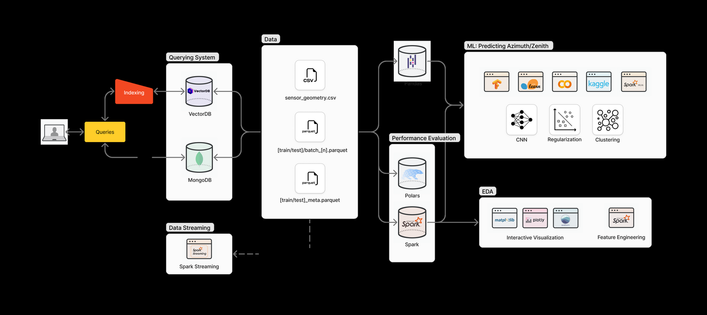
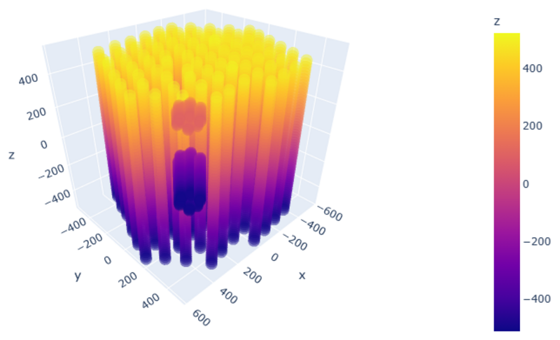
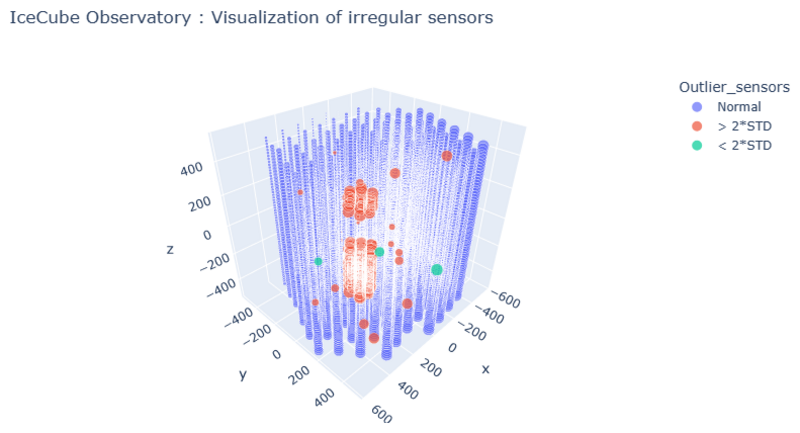

# Subzero Signals: Big-Data Analytics on IceCube Neutrinos

<p>
  
  
  
  
  
  
  
</p>

An end-to-end big-data system for the [IceCube Neutrinos in Deep Ice](https://www.kaggle.com/competitions/icecube-neutrinos-in-deep-ice) dataset: millions of light pulses recorded by 5,160 sensors buried in Antarctic ice. The goal is to **predict the direction a neutrino came from** (azimuth and zenith), so telescopes can be pointed at its source quickly.

The project covers the whole pipeline: distributed feature engineering, a framework benchmark, simulated live streaming, two query systems, interactive visualization and machine learning.

*Final project for NYU CS-GY 6513 Big Data (Spring 2024). Team: Rohaan Advani, Meghna Savit, Chinmayan Pradeep, Shrish Singhal.*

## Highlights

| | |
|---|---|
| ⚡ **Polars vs PySpark** | Same EDA workload ran in **27 s on Polars vs 73 s on PySpark** (~2.7× faster) |
| 🧠 **3D CNN** | Best direction model: **RMSE 1.50 (azimuth) / 0.54 (zenith)** radians, beating every regression baseline |
| 🔎 **Two query engines** | MongoDB for event filtering and aggregation; FAISS vector index for KNN, range, ANN and cosine search over angles |
| 🌊 **Streaming** | Spark Structured Streaming over chunked batch files, verified against a full-batch computation |
| 📊 **Outlier detection** | Interactive 3D Plotly views that flag noisy sensors in the detector |

## Architecture

<p align="center"></p>

## What's inside

### 1. Feature engineering with PySpark
Per-event features computed with group-bys and window functions: pulse counts, unique sensors, time and charge statistics, the share of fully digitized pulses, and sensor coverage. Sensor coordinates are converted to angles and event directions to Cartesian coordinates. Everything is wrapped in a reusable function that processes any batch file.

### 2. Performance: Polars vs PySpark
Reading, schema analysis, distributions and display were benchmarked on both frameworks. Polars' multi-threaded, columnar engine finished the same operations about 2.5–3× faster on a single machine.

### 3. Simulated data streaming
With no live detector feed, data is split into chunks that land in a watched folder every second. Spark Structured Streaming (`readStream` / `writeStream`, 3 s trigger) aggregates them incrementally.

### 4. Interactive visualization

<p align="center">
  
  
</p>

Left: the 5,160 sensors, coloured by depth. Right: sensors flagged as irregular (more than 2σ from normal pulse behaviour). Sensors with IDs above 5000, in the dense DeepCore region, record noticeably more partially digitized pulses.

### 5. Query systems
- **MongoDB:** filter events by duration or digitization rate, find the n-th largest values of a field, find events within a distance of a reference event, and compute distributions.
- **FAISS vector database:** an `IndexFlatL2` over normalized azimuth/zenith angles supporting k-nearest neighbours, range search, approximate nearest neighbours, cosine similarity and batched queries.

### 6. Machine learning: predicting neutrino direction

| Model | Data | Azimuth RMSE | Zenith RMSE |
|---|---|---|---|
| PyCaret model sweep (best: dummy baseline) | 10k events | 1.83 | 0.75 |
| PySpark linear regression | ~20k events | 1.80 | 0.69 |
| **3D CNN (TensorFlow/Keras)** | sensor-grid volume | **1.50** | **0.54** |

Azimuth spans 0–2π and zenith 0–π radians. The CNN treats the detector as a 3D volume where each voxel holds the time a sensor first saw light, which lets it use the spatial layout of the sensors. That explains why it beats tabular models that cannot see that layout. PySpark ML k-means was also used to cluster events by position, evaluated with silhouette score.

## Repository layout

| File | Contents |
|---|---|
| [`subzerosignals.ipynb`](subzerosignals.ipynb) | Main notebook: feature engineering, Polars benchmark, clustering, visualization, FAISS, streaming, regression |
| [`project-mongodb.ipynb`](project-mongodb.ipynb) | MongoDB ingestion and query system |
| [`CNN.ipynb`](CNN.ipynb) | 3D CNN for direction prediction (Google Colab) |
| [`Final Project Report.pdf`](Final%20Project%20Report.pdf) | Full write-up with methods, results and figures |
| [`Project Proposal.pdf`](Project%20Proposal.pdf) | Original proposal |

## Running it

1. Download the data from the [Kaggle competition page](https://www.kaggle.com/competitions/icecube-neutrinos-in-deep-ice/data): `train_meta.parquet`, `train/batch_*.parquet` and `sensor_geometry.csv`.
2. Install dependencies:
   ```bash
   pip install pyspark polars pyarrow pandas numpy plotly seaborn matplotlib faiss-cpu pycaret tensorflow scikit-learn pymongo tqdm
   ```
3. Update the data paths at the top of each notebook. The notebooks were developed on Kaggle and Google Colab because the dataset is too large for most laptops.
4. For the MongoDB notebook, provide credentials through environment variables:
   ```bash
   export MONGO_HOST=... MONGO_USER=... MONGO_PASSWORD=...   # optional: MONGO_AUTH_DB
   ```

## Challenges

- **Dataset size:** too big for the course JupyterHub, so heavy processing moved to Kaggle and Colab.
- **MongoDB from Kaggle:** connecting Kaggle to MongoDB Atlas was unreliable, so the query system was built on JupyterHub instead.
- **Model choice:** tabular regressors barely beat a mean predictor, which motivated a spatial (CNN) representation of the detector.
